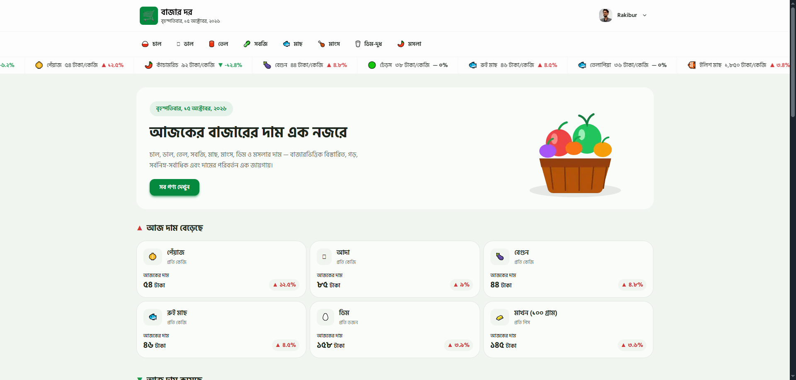

# বাজার দর (BazarDor)

### প্রয়োজনীয় পণ্যের দাম এক নজরে।

বাজার দর is a web application that helps users explore essential commodity prices in Bangladesh. It provides product details, market-wise price comparisons, and daily price changes in a simple, responsive interface.

## Screenshots

## Key Features

- **Daily Market Prices** - Explore prices of essential products, including rice, lentils, oil, vegetables, fish, meat, eggs, and spices.
- **Market-wise Price Comparison** - Compare prices across different markets.
- **Detailed Product Information** - View current prices, previous prices, percentage changes, and measurement units.
- **Price Statistics** - Check minimum, maximum, and average market prices.
- **Bengali User Interface** - Browse localized product names and prices with Bengali numerals and measurement units.

## Technologies Used

- Next.js
- React
- Tailwind CSS
- DaisyUI
- Better Auth
- MongoDB

## Live Demo

- **Live Website:** [BazarDor](https://bazar-dor-red-theta.vercel.app/)
- **GitHub Repository:** [View Source Code](https://github.com/rakibur-rafi/bazar-dor)

